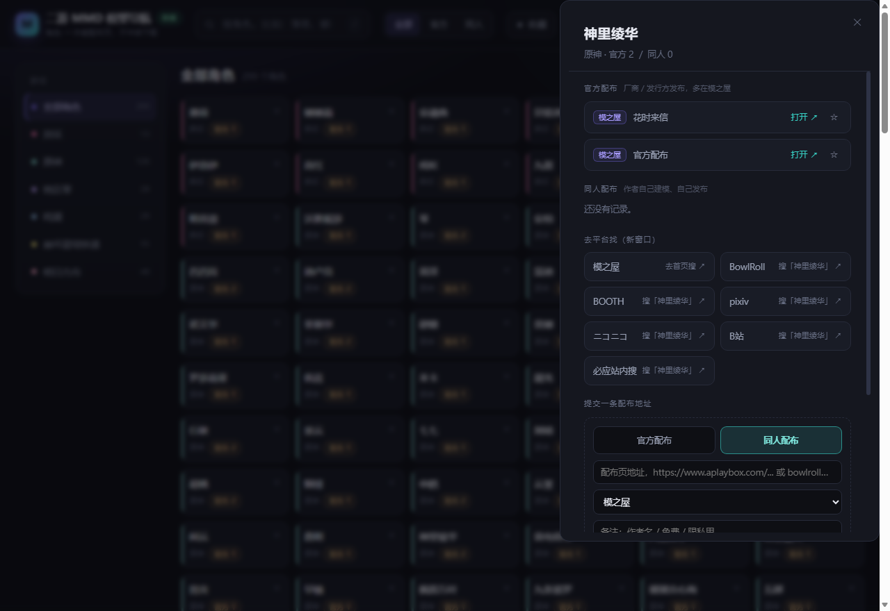

# 御北的小站 · 二游 MMD 模型导航

> **在线站点：<https://ybslmmd.cn/>**

按游戏分区整理二游角色的 MMD 模型**配布地址**，点角色直达作者本人的配布页。
不下载、不托管、不镜像任何模型文件——本站只做索引。


## 它解决什么问题

想做二游角色的 MMD，第一步就卡住：**这个角色的模型到底在哪下？**

官方模型散落在模之屋，同人模型散落在 BowlRoll / BOOTH / pixiv，还有一堆只在动态里发过、
根本搜不到的。这个站把「某角色有哪些配布、在哪、是官方还是同人」整理成一张表。

## 功能

| 功能 | 说明 |
|---|---|
| 分区 → 角色 → 地址 | 左边栏切游戏，点角色看配布列表 |
| 官方 / 同人分开 | 两种标签，授权差异一目了然 |
| 一键搜索 | 每个角色附带各平台搜索入口 |
| 收藏 | 注册后可收藏角色和单条地址，自建收藏夹，跨设备同步 |
| 提交与审核 | 访客可提交地址、申请新分区 / 新角色，站长审核后上线 |
| 更新日志 | 站点每次改动自动记录（`/#log`） |
| 管理员动态口令 | TOTP（验证器 6 位码），不是固定密码 |



## 技术栈

- **前端**：单个 `index.html`，原生 HTML/CSS/JS，无框架无构建
- **后端**：Python 3.11+ **标准库**，零第三方依赖
- **存储**：`data/` 下的 JSON 文件
- **部署**：nginx 反代 + Let's Encrypt 证书
- **数据**：全部人工核对，不抓取、不搬运模型

## 快速开始

```bash
python server.py 8000
# 打开 http://127.0.0.1:8000
```

第一次启动会在 `data/` 里自动生成管理员口令和动态口令密钥，
控制台会打印出来（用手机验证器扫码/手输密钥绑定）。

`data/` 里的密钥文件已在 `.gitignore` 中排除，**不会**出现在仓库里。

## 目录结构

```
.
├─ index.html              整站（含全部前端逻辑）
├─ server.py               后端：提交 / 审核 / 账号 / 收藏 / 日志
├─ data/                   运行时数据（密钥已 gitignore）
│  └─ published.json       分区 + 角色（本仓库保留角色骨架）
├─ deploy/                 部署相关
│  ├─ DEPLOY.md            完整上线手册
│  ├─ nginx.conf           反向代理 + HTTPS 配置
│  └─ server-setup.sh      服务器一键初始化
├─ Dockerfile
└─ docs/运维手册.md         详细的管理 / 审核 / SEO 说明
```

## 数据说明

仓库里只放**分区和角色名**，不放：

- 用户的账号和收藏
- 管理员口令、动态口令密钥、签名密钥
- 百度 / IndexNow 的推送凭证

具体配布地址请在站点上看——那是人工一条条核对出来的。

## 免责声明

- 本站只做链接索引，文件都在原作者 / 原平台。
- 二游角色模型版权属于**游戏厂商**，模型本身权利属于**建模作者**。
- 下载后请先读压缩包里的 `readme` / `利用規約`：二次配布、商用、R-18、署名规则各不相同。
- 公开传播前请确认授权。本项目不提供、也不建议使用游戏资源提取工具。

## 许可

代码以 MIT 协议开源，可自由使用和修改。

站点数据（分区 / 角色 / 配布地址）版权归整理者所有，
**禁止整站镜像与批量抓取**。
